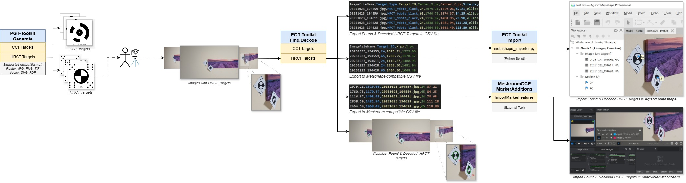
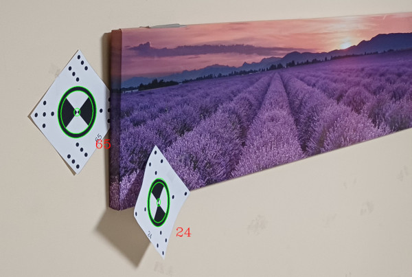
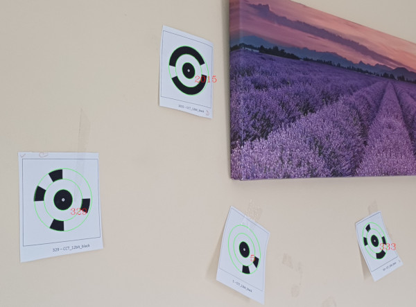

# PGT-Toolkit: Photogrammetry Target Toolkit


## Overview

**Photogrammetry Target Toolkit (PGT-Toolkit)** is a powerful, open-source Python application developed by *PGT Team*. It is designed to simplify the management and analysis of various *Coded Targets (Markers)* commonly used in photogrammetry software. It delivers a full suite of tools for generating, detecting, and decoding targets, along with comprehensive visualization and data export functions for software like *Agisoft Metashape* and *AliceVision Meshroom*, and other photogrammetry applications.

[](docs/images/PGT-Toolkit_Workflow.jpg)

*Figure 1: PGT-Toolkit workflow diagram.*


## Supported Coded Targets

The PGT-Toolkit supports the following coded targets, including both popular industry standards and newly developed types, allowing flexibility across different photogrammetry workflows:

* **Circular Coded Targets (CCT):** Standard circular patterns for robust detection, commonly used in software like *Agisoft Metashape* and similar commercial systems.

    [](docs/images/Targets_CCT_199-203.png)
    
    *Figure 2: Example of generated CCT_12bit_black Targets with IDs = {199, 201, 203} in raster images.*

* **Human Readable Coded Targets (HRCT):** Coded targets that incorporate human-readable identifiers for easy manual verification. ***This is a novel target type, developed in-house by PGT team.*** [More Details in README_HRCT.md](/docs/README_HRCT.md)

    [](docs/images/Targets_HRCT_54-56.png)
    
    *Figure 3: Example of generated HRCT_9dots_black Targets with IDs = [54, 55, 56] in raster images.*


**Practical Usage Note.** The size of the coded targets should not be too big or too small compared to the object or scene. It is recommended that the radius of the target center circle on the taken photo is more than 20 pixels.


## Core Features

This module implements a full suite of operations to manage the lifecycle of coded targets:

| Feature | Description |
| :--- | :--- |
| **Finding & Decoding** | Automatically **finds** targets in images and **decodes** their IDs. |
| **Visualization** | **Draws** detected targets, including their borders and decoded IDs, onto images for visual inspection and verification. |
| **Generation** | **Generates** target patterns in high-resolution, printable formats, supporting both raster (PNG, JPG, TIF, BMP) and vector (SVG, PDF) formats, ready for physical deployment. |
| **Data Export** | **Exports** target data (e.g., IDs, sizes, image positions) to structured **CSV files** for integration with external photogrammetry software. |


[](docs/images/Found_HRCT_Targets.jpg)

*Figure 4: Example of found and decoded HRCT_9dots_black Targets with IDs = [24, 65].*


[](docs/images/Found_CCT_Targets.jpg)

*Figure 5: Example of found and decoded CCT_12big_black Targets with IDs = [5, 329, 333, 2015].*


[](docs/images/Export_HRCT_Targets_to_CSV.png)

*Figure 6: Example of exporting the found and decoded HRCT_9dots_black Targets with IDs = [24, 65] to CSV file.*


## Installation

To set up and run the PGT-Toolkit, you should use a Python virtual environment to manage dependencies.

Note. The PGT-Toolkit is developed and tested using **Python 3.11.8**. It is highly recommended that you use this version, or a compatible 3.x release, to run the application.

### 1. Access the Project

You can access the project files in two ways:

### Option A: Clone the Repository (Recommended)

To use the Git version control features, clone the repository using the HTTPS URL:

1.  **Clone and Navigate:** Open your terminal and run the following commands to clone the project and enter the folder:

    ```bash
    git clone https://github.com/milen-borisov/pgt-toolkit.git
    cd pgt-toolkit
    ```

### Option B: Download ZIP File

Alternatively, you can download the project as a ZIP file from the main repository page, extract it, and then navigate to the resulting `pgt-toolkit` folder.

### 2. Create and Activate the Virtual Environment

It is highly recommended to use a virtual environment (`.venv` or similar) to isolate project dependencies.

**Windows (Command Prompt):**

    python -m venv .venv
    .\.venv\Scripts\activate.bat

**Windows (PowerShell):**

    python -m venv .venv
    .\.venv\Scripts\Activate.ps1

**macOS / Linux (Bash/Zsh):**

    python3 -m venv .venv
    source .venv/bin/activate


### 3. Install Dependencies

With the virtual environment activated, install all required packages listed in `requirements.txt`:

    pip install -r requirements.txt

You are now ready to run the application using Command Line Interface (CLI) or Graphic-User Interface (GUI).


## How to Use the PGT-Toolkit

**Configuration Note:** Most core detection, decoding, and drawing parameters use default values defined in the `settings.yaml` file. Users can modify them to adjust some settings without changing the core Python code.

### Using Graphic-User Interface (GUI)

A **Graphical User Interface (GUI)** is available for all core operations, including ` Find Targets` and `Generate Targets`.

To run the GUI PGT-Toolkit application, execute the following command in your Terminal:
```bash
python src/main_gui.py
```

The GUI provides a user-friendly way to configure and execute the PGT-Toolkit, as well as access key files through the **Settings** and **Help** menus.

[](docs/images/PGT-Toolkit_GUI_Find.png)

*Figure 6: PGT-Toolkit GUI - Find Targets.*


[](docs/images/PGT-Toolkit_GUI_Generate.png)

*Figure 7: PGT-Toolkit GUI - Generate Targets.*


### Using Command-line Interface (CLI)

The PGT-Toolkit application uses a command-line interface (CLI) to execute all core operations. All operations are run via the `src/main_cli.py` script.

The CLI is structured to handle two main commands: find (for detecting and decoding targets in images) and generate (for creating new printable target patterns).

#### 1. Find Targets in Images (`find`)

Use the `find` command to run the core detection and decoding logic across a folder of input images.

**Example Command:**
```bash
python src/main_cli.py find
    --type "HRCT_9dots_black" 
    --input-folder "data/images/"
    --res-folder "results/"
    --csv-name "found_targets.csv"
    --threshold-modes adaptive otsu max
    --threshold-values 10 245
    --no-draw
    --no-metashape
    --no-meshroom
```
**Required Arguments:**

* **`--type`**: Specifies the type of coded target to detect (e.g., `CCT_8bit_black`, `HRCT_9dots_black`, etc.).

* **`--input-folder`**: Path to the folder containing the source images.

* **`--res-folder`**: Path to the directory where all output files will be saved. This includes CSV result files and optionally images with drawn targets in `images` sub-folder.

* **`--csv-name`**: Base CSV filename for the primary decoded results. 

    Note. Photogrammetry-specific exports (Meshroom, Metashape) will use this base name with an added suffix, resp.

* **`--threshold-modes`**: Specify which thresholding modes to enable. Choose one or more from the following options: 
  * `adaptive`: (Highly Robust, Performance Penalty) Enables local thresholding, making it highly robust to varied lighting conditions.
  * `otsu`: (Fast, Less Robust) Enables global thresholding using Otsu's method. It's fast, but less reliable with varied or uneven lighting.
  * `max`: (Dark Target Focus) Enables thresholding based on the Histogram Peak. It is recommended specifically for dark target detection.

* **`--threshold-values`**: Optional. Use to define custom threshold points. Supply one or two integer values in the range 0 to 255. These values are used for enhanced detection of dark and/or bright targets.
  
  
**Optional Flags:**

| Flag | Purpose | Default Behavior | 
| :--- | :--- | :--- | 
| `--no-draw` | Disables drawing detected targets onto output images. | Enabled | 
| `--no-meshroom` | Disables exporting results to Meshroom-compatible CSV format. | Enabled | 
| `--no-metashape` | Disables exporting results to Metashape-compatible CSV format. | Enabled | 


#### 2. Generate Target Markers (`generate`)

Use the `generate` command to create new coded target markers and associated files based on a specified target type. This command is essential for generating the unique target images and patterns needed for your photogrammetry workflow.

**Example Command:**

``` bash
python src/main_cli.py generate
    --type "HRCT_9dots_black"
    --res-folder "targets/generate_hrct/"
    --res-image-type "svg" 
    --res-image-size 1000
    --res-max-images "all"
```

**Required Arguments:**

* **`--type`**: Specifies the type of coded target to generate (e.g., `CCT_8bit_black`, `HRCT_9dots_black`, etc.). This determines the specific pattern and decoding logic.
* **`--res-folder`**: Path to the output directory where all generated target images and configuration files will be saved.


**Output Control Arguments (Optional):**

| Argument | Purpose | Default | 
| :--- | :--- | :--- | 
| **`--res-image-type`** | The file format for the generated target images. Supported options include: `jpg`, `png`, `tif`, `svg`, `pdf`. | **`png`** |
| **`--res-image-size`** | The size of the square side of the generated target image, specified in **pixels**. Used only for raster image (JPG, PNG, TIF, BMP).| **`480`** | 
| **`--res-max-images`** | The **maximum number of unique target images** to generate. Acceptable values are a positive integer (e.g., `10`, `100`, ...) or the strings **`"all"`** or **`"-1"`** to generate all possible unique targets. | **`-1`** | 


## Photogrammetry Integration Tools

This PGT-Toolkit includes specialized Python scripts for seamlessly importing the detected coded targets into popular photogrammetry software.

### 1. Agisoft Metashape Integration

The `src/metashape` folder contains helper scripts designed to import decoded markers directly into an open Metashape project chunk, simplifying the control point workflow.

**Primary Script:** `metashape_importer.py`

**Full Instructions:** For details on prerequisites, CSV format, and step-by-step usage, see the dedicated [Metashape Marker Tools README](docs/README_Metashape.md).


### 2. Meshroom Integration

The `src/meshroom` folder contains helper scripts necessary to format and import decoded markers for use as control points within a Meshroom pipeline.

**Full Instructions:** For details on prerequisites and usage, see the dedicated [Meshroom Marker Tools README](docs/README_Meshroom.md).


## Future Marker Support
We plan to include support for other targets like **CCTag**, **AprilTag** and **ArUco**.


## Contact

For bug reports, feature requests, or collaboration inquiries, please contact the lead developer, Milen Borisov, via email: **milen_kb@math.bas.bg**.


## Citation

If you utilize PGT-Toolkit in academic work or projects, please cite both the software and the related article describing its underlying methodology.

**1. Software Citation:**

Please use one of the following formats to cite the PGT-Toolkit software:

**APA:** Borisov, M., & PGT Team. (2025). PGT-Toolkit: Photogrammetry Target Toolkit (Version 1.0.0) [Computer software]. GitHub. https://github.com/milen-borisov/pgt-toolkit.git

**MLA:** Borisov, M., and PGT Team. PGT-Toolkit: Photogrammetry Target Toolkit. Version 1.0.0, GitHub, 2025, https://github.com/milen-borisov/pgt-toolkit.git.

**2. Related Article Citation:**
The full technical details and validation of the HRCT design are included in a manuscript currently under review for peer-reviewed publication. For formal citation information or access to the draft, please contact the PGT team directly.


## Funding and Acknowledgments 💡

The authors would like to thank the *Bulgarian National Science Fund* for funding the research under the project *"AN INTEGRAL APPROACH IN CREATING DIGITAL TWINS OF ARCHEOLOGICAL IMMOVABLE MONUMENTS USING INNOVATIVE TECHNOLOGIES,"* Contract No. KP-06-N82/1 (dated 06.12.2024).

This work was also conducted at the Institute of Mathematics and Informatics, Bulgarian Academy of Sciences (IMI-BAS), Sofia, Bulgaria.

Additionally, some foundational ideas for the CCT Targets detection and decoding functionality are derived from the work available at the [CCTDecode GitHub repository](https://github.com/poxiao2/CCTDecode).


The authors acknowledge the use of Gemini (a large language model developed by Google) for advice on code design, structuring, and refactoring, as well as for general development assistance throughout the implementation of the PGT-Toolkit.


## License

PGT-Toolkit is released under the open-source Apache License, Version 2.0. See the [LICENSE](LICENSE.txt) file for details.

Copyright (c) 2025 Milen Borisov & PGT Team

