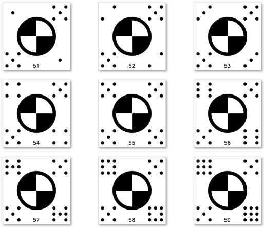

# Human Readable Coded Targets (HRCT) Documentation

This document provides detailed information on the Human Readable Coded Targets (HRCT) developed in-house by the PGT team. HRCTs successfully overcome the core limitation of conventional targets by embedding a clear, numeric identifier directly into the pattern, ensuring reliable and verifiable decoding by both automated software and human operators.

## Concept and Rationale

The core limitation of conventional coded targets is their exclusive dependence on software for decoding the purely binary patterns, which prevents any meaningful human identification or verification. HRCT targets resolve this by design: they embed a clear, numeric identifier directly into the target's structure, making the marker pattern easily and reliably decodable by humans as well as automated systems.

*Figure 1: Example of HRCT_9dots_black Targets with IDs = [54, 55, 56].*

## Physical Structure and Coding Mechanism (Novel Design by PGT Team)

This novel target type, developed entirely by the PGT team, features a distinctive center and a unique, redundant coding scheme to ensure robustness.

### A. Central Structure
The marker's central fiducial mark is designed as a Circular Cross, formed by a black ring with an interior that is divided into four equal sectors. Two of these sectors are filled white and are positioned diagonally opposite the remaining two black sectors, creating a perfect cross shape. This central element is critical for:

1. High-Precision Localization: Its high-contrast symmetry guarantees robust and precise localization (centroid determination) for automated detection.

2. Target Orientation: It provides a necessary visual and geometric reference to establish the target's orientation relative to the coding sectors.

### B. Coding Mechanism
The HRCT system encodes a two-digit code (ranging from 00 through 99) using a unique and redundant pattern based on the following rules:

1.  **Code Placement:** The two-digit identifier is physically represented by two distinct dot-count patterns placed in the four external quadrants of the marker, surrounding the central circular cross.
2.  **Positional Value:**
    * The **White Sectors** of the central cross correspond to the **Tens Digit** of the code.
    * The **Black Sectors** of the central cross correspond to the **Units Digit** of the code.
3.  **Die-Dot Pattern:** Each digit is unambiguously encoded by a Die-Dot Pattern of up to nine dots (where 0 dots represents '0', 1 dot represents '1', and so on, up to 9 dots representing '9'). The redundant placement (two regions for each digit) ensures high decoding reliability.

    
    
    *Figure 2: Example of how each digit is encoded in HRCT Targets; see the black sectors encoding the *units digit*.
   
    *Note. The pattern resembles the dot arrangements found on a standard gaming die (zar). This encoding of digits/numbers is highly familiar to all people from games, which aids in quick manual verification.*
   
4.  **Redundancy (Duplex Encoding):** The full code is written redundantly (doubled) across the target. Both white sectors encode the Tens Digit, and both black sectors encode the Units Digit. This mirrored design ensures the target is decodable regardless of orientation and provides built-in error checking.

## Key Features and Advantages

The novel HRCT design successfully merges the precision of machine vision with the practicality of human intuition, yielding significant operational benefits:

| Feature | Description | Operational Benefit | 
| ----- | ----- | ----- | 
| **Hybrid Decodability** | The dual coding pattern and die-dot representation allows for decoding by both the PGT-Toolkit software and a human operator. This enables manual verification or decoding when the software fails. | **Reduced Errors & Redundancy:** Provides a robust fallback mechanism that minimizes errors and confusion, supporting manual verification when software decoding fails. | 
| **Custom Generation** | Users can define geometric parameters and codes for target creation using the `hrct_generator` section in `settings.yaml`. | **Maximum Flexibility:** Users can tailor target size to match their specific needs. For example, the default settings generate HRCT targets with a center that can be recognized by *Leica* laser scanners. | 
| **Config Management** | Settings used in `hrct_generator` **must** be mirrored in the `hrct_decoder` section of `settings.yaml` for correct decoding. | **Guaranteed Consistency:** Ensures the decoding algorithm uses the exact parameters (e.g., dot size, spacing) used during target generation. | 
| **AI/Deep Learning Optimized** | The distinct, high-contrast geometric features (Circular Cross center and Die-Dot patterns) provide excellent training data and robust feature localization. | **Future-Proof Detection:** The clean, simple geometry is highly suitable for object detection and semantic segmentation models, paving the way for faster, AI-accelerated finding and decoding. |
| **Compact Encoding** | The dot-count coding mechanism removes the need for large, decimal human-readable numbers to be printed on the target. | **Compactness:** Allows for a smaller, cleaner target design without visual clutter, critical for decoding applications. | 
| **High Occlusion Tolerance** | The target's simple geometry and the duplex (double) encoding of the code ensure high tolerance. Even if one-third (1/3) of the target is obscured, the center and code can often still be recognized. | **Improved Field Reliability:** Increases the probability of successful identification even under harsh site conditions or partial damage. | 
| **Distance Readability** | The distinct pattern and large, simple dots are easily identifiable by the human eye from a distance. | **Increased Efficiency:** Facilitates rapid on-site data linking and aids the operator during object acquisition. | 
| **Machine Vision Optimized** | The target geometry is optimized for traditional photogrammetry programs (like PGT-Toolkit). | **Time Savings:** Programs can identify the marker automatically for precise image alignment, scaling, and georeferencing. | 
| **Duplex Error Reduction** | The entire two-digit code is written redundantly (doubled) across the target. | **Enhanced Accuracy:** Significantly reduces errors during both automated and manual decoding. |

## Summary

The HRCT is a novel concept that successfully combines the sub-pixel precision of machine vision with the practical reliability of human manual verification. This design provides superior operational benefits, including maximum decoding confidence due to its redundant, duplex coding, and exceptional field reliability under conditions that would cause traditional targets to fail. The result is a robust photogrammetry marker system that significantly reduces error rates and ensures guaranteed data integrity across both automated and manual workflows.

