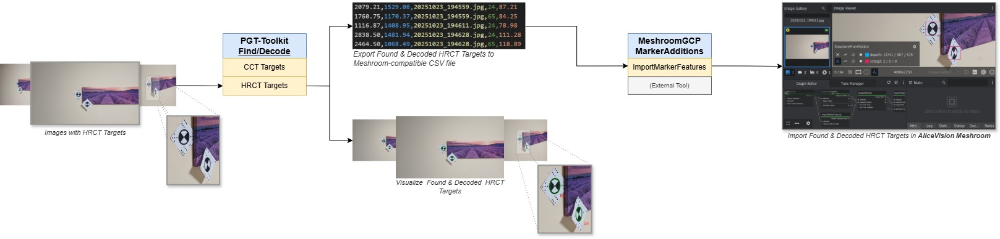

# Meshroom Tools and Integration

This package contains utility scripts and methods specifically designed for interoperating with the *AliceVision Meshroom* photogrammetry software.

The primary function of this module is to generate marker/target files in a format compatible with external Meshroom tools.

## Workflow for Importing Coded Targets

*Figure 1: Workflow diagram for importing HRCT Targets in Meshroom.*

To successfully import the coded target data generated by this project into a Meshroom photogrammetry pipeline, you must use the following third-party extension:

**Prerequisite Meshroom Extension:**

* **Project:** [MeshroomGCPMarkerAdditions](https://github.com/MrClock8163/MeshroomGCPMarkerAdditions)

* **Purpose:** This extension provides the necessary nodes (specifically, the `ImportMarkers`) to load markers from an external file into your Meshroom graph.

### Step-by-Step Usage

1. **Generate Marker CSV:** Enable the option for exporting found targets to Meshroom-compatible CSV format.

    Note. The output "<file_name>_meshroom.csv" file is the structured CSV file containing all target IDs and their pixel and size coordinates.

2. **Integrate Meshroom Extension:** Follow the instructions provided in the `MeshroomGCPMarkerAdditions` repository to install and integrate the new nodes into your Meshroom installation.

3. **Run Pipeline:** In your Meshroom graph, use the imported nodes (e.g., `ImportMarkers` or similar) and point them to the csv file generated in Step 1. This injects the coded target coordinates into the image data for processing.