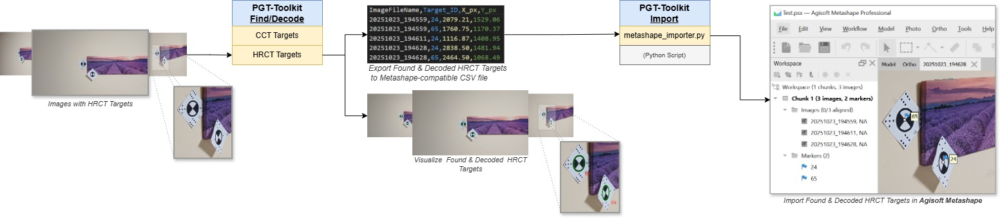

# Metashape Marker Tools

This package contains a Python script designed for importing externally found coded targets (markers) from csv file into an Agisoft Metashape software.

## Import Targets in Metashape

*Figure 1: Workflow diagram for importing HRCT Targets in Metashape.*

Note. Use the script called `metashape_importer.py` for importing the founded/coded targets in Metashape software.

### Things You Need (Prerequisites)

1. **Generate Marker CSV:** Enable the option for exporting found targets to Metashape-compatible CSV format.

    Note. The output "<file_name>_meshroom.csv" file is the structured CSV file containing all target IDs and their pixel and size coordinates.

2.  **MetashapeProject Ready:** Have Metashape open and your images loaded into the active chunk.
   
    Note. Ensure that all images referenced in the CSV file are already loaded into the active Metashape chunk. The script cannot place markers on photos that are not present in the project.

### How to Use the Script (Step-by-Step)

This script needs to be run from *inside* the Metashape application.

1.  **Open Up Metashape:** Start the program and load the project where your images are.

2.  **Run the Script:** Go to the main menu and click **Tools > Run Python Script...**.

3.  **Find the File:** Navigate to the location of the `metashape_importer.py` file and select it to load.

    Note. The `metashape_importer.py` script is located in the 'src/metashape_tools' folder of the PGT-Toolkit project.

4.  **Choose Your CSV:** A file dialog window will appear. Select the CSV file that was prepared in Step 1 (from the Prerequisites section).

5.  **Markers Imported:** The script will automatically read the data, match the image filenames, and place the markers at the specified pixel coordinates.

